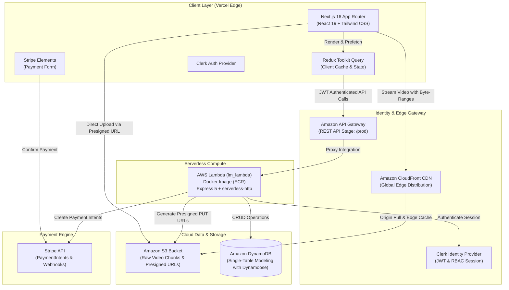
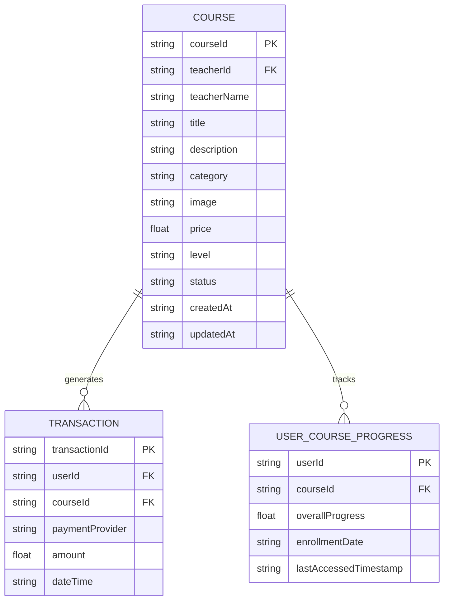
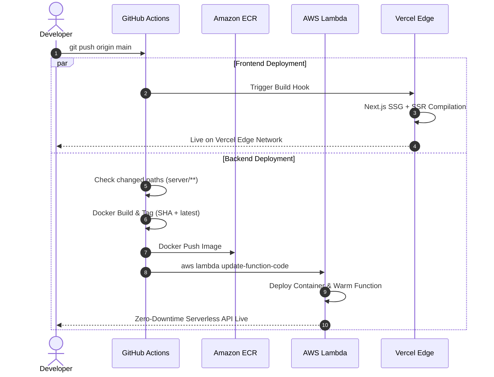

<div align="center">

# 🎓 LearnSphere — Cloud-Native Learning Management System

An enterprise-grade, serverless Learning Management System (LMS) built with **Next.js 16**, **React 19**, **AWS Serverless Architecture (Lambda, DynamoDB, S3, CloudFront)**, **Stripe Payments**, and **Clerk Authentication**.

[](https://nextjs.org/)
[](https://react.dev/)
[](https://www.typescriptlang.org/)
[](https://aws.amazon.com/)
[](https://aws.amazon.com/dynamodb/)
[](https://aws.amazon.com/cloudfront/)
[](https://stripe.com/)
[](https://clerk.com/)
[](https://www.docker.com/)

[Explore Features](#-key-features) • [Architecture](#-cloud--system-architecture) • [Tech Stack](#-technical-stack) • [Quick Start](#-quick-start-guide) • [API & Data Model](#-data-modeling--database-design)

</div>

---

## 🌟 Executive Overview

**LearnSphere** is a high-performance, full-stack video learning and course marketplace platform engineered for massive scalability, low latency, and zero server maintenance.

Engineered with modern full-stack best practices, it addresses real-world challenges including:

- **Direct-to-Cloud Video Ingestion**: Presigned S3 uploads bypassing application servers for gigabyte-scale video files.
- **Global Low-Latency Streaming**: Accelerated video delivery via Amazon CloudFront edge nodes with fine-grained CORS and byte-range request support.
- **Microservice-Free Serverless Backend**: Express 5 application packaged with `serverless-http` deployed on AWS Lambda container images via Amazon ECR.
- **Resilient Financial Transactions**: PCI-compliant Stripe Payment Element integration with automatic client-secret synchronization and failure recovery.
- **Modern State Management**: Normalized server caching, optimistic updates, and instant UI feedback powered by Redux Toolkit Query (RTK Query).

---

## 🏗️ Cloud & System Architecture



---

## 🚀 Key Features

### 👨‍🎓 Student Experience

- **Course Discovery & Search**: Fast multi-attribute filtering (category, price, difficulty level) with debounced search.
- **Seamless 3-Step Checkout Wizard**:
  - Step 1: Order verification & guest/account onboarding.
  - Step 2: Payment processing via Stripe Elements with dark-theme styling, automatic card detection, and error handling.
  - Step 3: Instant transaction receipt and automated enrollment confirmation.
- **Interactive Video Player**:
  - Native HTML5 video player with adaptive stream buffering and byte-range scrubbing.
  - Automatic completion tracking: marks chapter completed when user reaches **80%** watch time.
  - Chapter notes, resource downloads, and interactive quiz tabs.
- **Student Dashboard**: Real-time course progress tracking, billing invoice history, and enrolled course library.

### 👩‍🏫 Instructor & Creator Studio

- **Dynamic Curriculum Builder**: Drag-and-drop course reordering, multi-section organizing, and chapter management.
- **Direct S3 Video Uploader**: FilePond-integrated direct chunk upload generating AWS S3 Presigned URLs to prevent server memory saturation.
- **Teacher Analytics & Billing**: Real-time sales calculations, enrollment numbers, revenue charts, and transaction audits.
- **Course Publishing Lifecycle**: Draft, review, publish, and archive workflows.

### 🔐 Security & Infrastructure Excellence

- **Role-Based Access Control (RBAC)**: Fine-grained middleware authorization segregating teacher and student endpoints via Clerk.
- **Zero-Downtime CI/CD Pipeline**: GitHub Actions automatically builds multi-stage Docker images, pushes to Amazon ECR, and triggers zero-downtime AWS Lambda code updates.
- **Enterprise Storage Policies**: S3 Bucket ownership enforcement, block public access, Origin Access Control (OAC), and CloudFront managed CORS preflight policies.

---

## 🛠️ Technical Stack

| Domain                   | Technologies                                                                |
| ------------------------ | --------------------------------------------------------------------------- |
| **Frontend Framework**   | **Next.js 16.2** (App Router, Server & Client Components, Turbopack)        |
| **UI Library & Styling** | **React 19.2**, **Tailwind CSS**, **Radix UI Primitives**, **Lucide Icons** |
| **State & API Cache**    | **Redux Toolkit 2.x**, **RTK Query** with automatic cache invalidation      |
| **Authentication**       | **Clerk** (Social Login, JWT Tokens, User Metadata, Custom Sessions)        |
| **Payment Gateway**      | **Stripe** (Elements, PaymentIntents API, Webhooks)                         |
| **Backend Runtime**      | **Node.js 22**, **Express 5**, **TypeScript**, **serverless-http**          |
| **Serverless Compute**   | **AWS Lambda** (Container image runtime via Amazon ECR)                     |
| **API Gateway**          | **Amazon API Gateway** (REST API with proxy routes)                         |
| **Database**             | **Amazon DynamoDB** with **Dynamoose ODM**                                  |
| **Media & CDN**          | **Amazon S3** (Presigned URLs) + **Amazon CloudFront** (Global Edge CDN)    |
| **DevOps & Containers**  | **Docker** (Multi-stage build), **GitHub Actions** (CI/CD to AWS)           |

---

## 📊 Data Modeling & Database Design

The database layer utilizes **Amazon DynamoDB** via Dynamoose to ensure single-digit millisecond latency at any read/write volume:



---

## 📂 Project Structure

```text
learning-management/
├── .github/
│   └── workflows/
│       └── deploy-server.yml      # CI/CD: Automated ECR Build & Lambda Deployment
├── client/                        # Next.js 16 Frontend
│   ├── public/                    # Static assets & public media
│   ├── src/
│   │   ├── app/
│   │   │   ├── (dashboard)/       # Authenticated Student & Teacher Dashboards
│   │   │   │   ├── teacher/       # Courses manager, creation, analytics
│   │   │   │   └── user/          # Enrolled courses, video player, billing
│   │   │   ├── (nondashboard)/    # Public Landing, Search & Checkout Wizard
│   │   │   │   ├── checkout/      # Multi-step checkout (Details, Payment, Completion)
│   │   │   │   └── search/        # Course catalog with faceted search
│   │   │   ├── globals.css        # Tailored dark-mode tokens & CSS utilities
│   │   │   └── layout.tsx         # Root layout with Clerk & Redux providers
│   │   ├── components/            # Reusable UI primitives & compound components
│   │   ├── hooks/                 # Custom React hooks (Checkout, Progress, Auth)
│   │   ├── lib/                   # Utility helpers, Zod validation schemas
│   │   └── state/
│   │       ├── api.ts             # Central RTK Query API slice with custom baseQuery
│   │       └── index.ts           # Redux store configuration
│   ├── package.json
│   └── tailwind.config.ts
├── server/                        # Express 5 Serverless Backend
│   ├── src/
│   │   ├── controllers/           # Course, Transaction, User Progress handlers
│   │   ├── models/                # Dynamoose DynamoDB schemas (Course, Transaction, Progress)
│   │   ├── routes/                # Express API routing with Clerk authentication guards
│   │   ├── seed/                  # Database seeding scripts & mock datasets
│   │   └── index.ts               # Server bootstrap, middleware & Lambda handler export
│   ├── Dockerfile                 # Multi-stage production container image
│   ├── package.json
│   └── tsconfig.json
└── README.md
```

---

## ⚙️ Quick Start Guide

### Prerequisites

- **Node.js** >= 18.x
- **npm** or **pnpm**
- **AWS CLI** configured with appropriate IAM credentials
- **Docker** (optional, for local containerized server execution)

### 1. Clone Repository

```bash
git clone https://github.com/prashantsingh-codes/learning-management.git
cd learning-management
```

### 2. Configure Environment Variables

#### Client Configuration (`client/.env.local`):

```env
NEXT_PUBLIC_API_BASE_URL=http://localhost:8001
NEXT_PUBLIC_LOCAL_URL=http://localhost:3000
NEXT_PUBLIC_STRIPE_PUBLIC_KEY=pk_test_...
NEXT_PUBLIC_CLERK_PUBLISHABLE_KEY=pk_test_...
CLERK_SECRET_KEY=sk_test_...
NEXT_PUBLIC_CLERK_SIGN_IN_URL=/signin
NEXT_PUBLIC_CLERK_SIGN_UP_URL=/signup
```

#### Server Configuration (`server/.env`):

```env
PORT=8001
NODE_ENV=development
AWS_REGION=us-east-1
S3_BUCKET_NAME=your-s3-bucket-name
CLOUDFRONT_DOMAIN=https://your-cloudfront-distribution.cloudfront.net
STRIPE_SECRET_KEY=sk_test_...
CLERK_PUBLISHABLE_KEY=pk_test_...
CLERK_SECRET_KEY=sk_test_...
```

### 3. Run Locally

#### Start the Server:

```bash
cd server
npm install
npm run dev
# Server runs on http://localhost:8001
```

#### Start the Client:

```bash
cd ../client
npm install
npm run dev
# Next.js app available at http://localhost:3000
```

---

## 🚢 CI/CD & Deployment Strategy



---

## 👨‍💻 Engineering Highlights & Problem Solving

- **Cross-Origin Media Streaming**: Resolved complex browser media playback deadlocks by configuring AWS CloudFront with a dedicated `Managed-CORS-With-Preflight` Response Headers Policy and migrating from synthetic player wrappers to native HTML5 video engines with byte-range support.
- **Stripe PCI Compliance & UX Optimization**: Implemented seamless payment recovery with automatic client-secret synchronization, night-mode tokenization, and fallback public keys ensuring checkout success across development, preview, and production environments.
- **Memory-Safe Video Upload Pipeline**: Bypassed server memory limits by implementing direct-to-S3 signed URLs (`s3.getSignedUrl('putObject')`), allowing teachers to upload large video files directly from the browser with zero server CPU utilization.

---

## 👤 Author

**Prashant Singh**

- **GitHub**: [@prashantsingh-codes](https://github.com/prashantsingh-codes)
- **LinkedIn**: [Connect on LinkedIn](https://www.linkedin.com/in/prashant-singh-codes/)

---

<div align="center">
  <sub>Built with modern software engineering principles, cloud architecture, and attention to detail.</sub>
</div>
